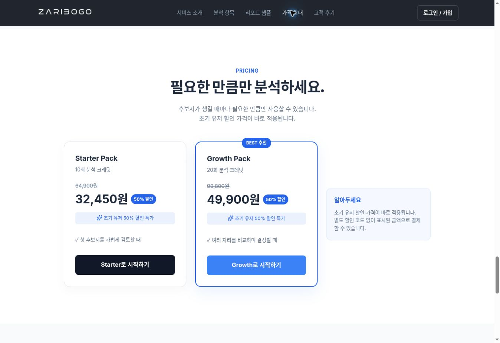
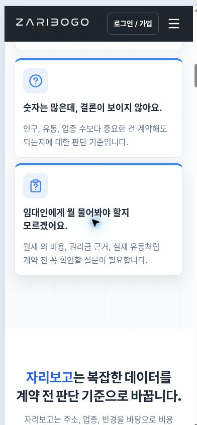
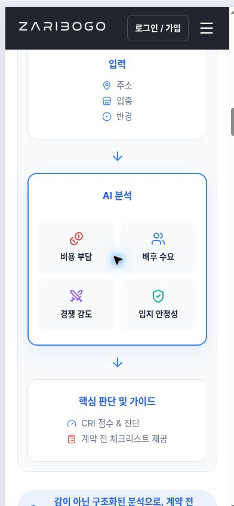
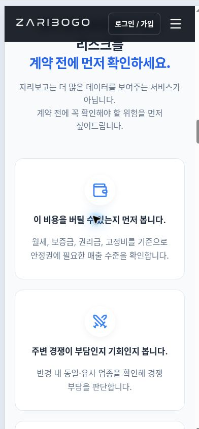
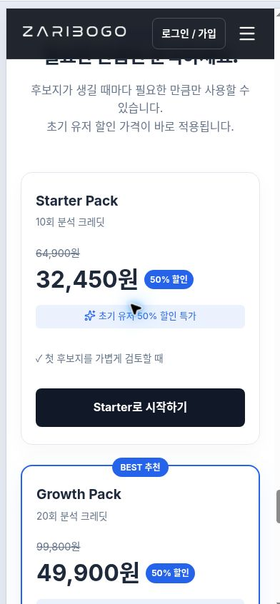
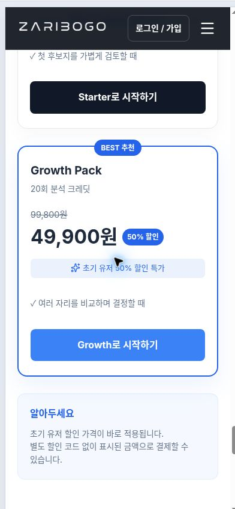
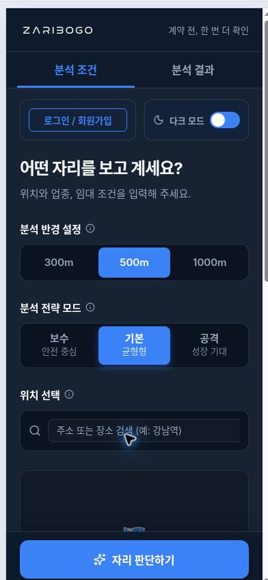
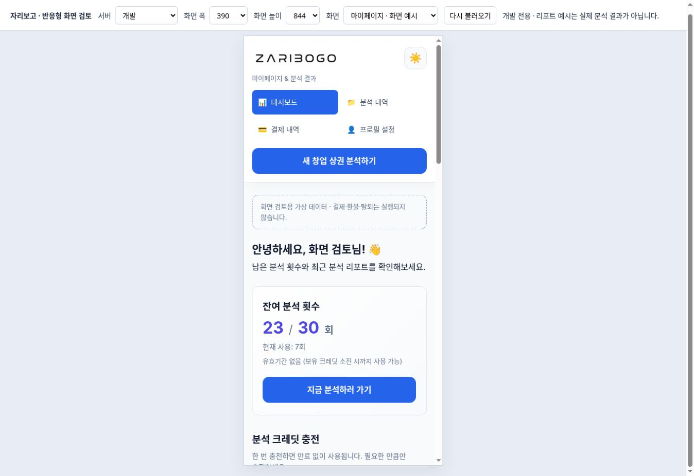

# Codex 개발 인계

기록일: 2026-11-19 (한국시간)

## 현재 상태

- 소스 기준: `bigbearboss/-zaribogo`, 시작 커밋 `dc7f4f6`.
- 이번 작업 브랜치: `codex/mobile-ready`.
- 기존 Vite/TypeScript 구조를 유지한다. 새 프레임워크나 새 DB로 이전한 것이 아니다.
- 소스를 Codex 환경에서 실행했고 모바일 화면을 수정했다. 2026-11-19 사용자 승인 후 운영 브랜치에 병합했고 Cloudflare 정식 배포와 www.zaribogo.com 반영을 확인했다.
- 기존 Antigravity 컴퓨터의 미커밋 파일과 `.env`는 이 Git 저장소에 포함되어 있지 않으므로, 원본 로컬 작업이 있다면 별도 비교해야 한다.
- 개발 환경에 실제 API 설정값이 없어 로그인·지도·실데이터 분석·저장·결제를 통합 검증하지 못했다.

## 정식 배포 확인

- 운영 주소: https://www.zaribogo.com/
- PR #1 병합 커밋: `a37ecf601d03db049c97fb527c2de563c7fd4e38` (사용자 명시적 배포 승인).
- Cloudflare Pages 배포 성공: https://7ebaa0ed.zaribogo.pages.dev/
- 운영 도메인에서 질문 아이콘, 주요 기능 카드의 32px 상하 여백, 새 요금제 카드 및 모바일 CSS 반영을 확인했다.
- 소개 → 분석 조건 화면 전환, Kakao 지도 표시 및 서울시청 주소 검색 결과를 확인했다.
- 로그인 후 분석·저장·크레딧 차감·결제는 이번 배포에서 실행하지 않았다.

## 첫 미리보기 확인 기록 (운영 반영 전)

- PR: https://github.com/bigbearboss/-zaribogo/pull/1 (병합 완료)
- 브랜치 미리보기: https://codex-mobile-ready.zaribogo.pages.dev/
- 확인한 배포: https://8b1a2197.zaribogo.pages.dev/ (`9eea3d7`, Cloudflare Pages check 성공)
- 실제 배포 화면에서 소개 → 입력 화면 전환, 입력값 변경, 연결 불가 안내 및 분석 버튼 복구를 확인했다.
- Preview 빌드에서 `VITE_KAKAO_MAP_APP_KEY`가 누락되었다는 오류를 확인했다. Supabase URL/공개 키도 하나 이상 미설정되어 분석 연결 안내가 표시된다.
- 기존 Production의 필요한 클라이언트 설정을 Preview 환경에도 연결한 뒤 다시 빌드해야 한다. 비밀키를 소스나 채팅으로 전달할 필요는 없다.
- 로그인·실제 지도·실데이터·결제 검증은 아직 수행하지 않았다. 브랜치 미리보기 성공을 실제 서비스 연동 성공으로 보지 않는다.

배포된 소개 페이지 기록: [deployed-preview.jpg](screenshots/deployed-preview.jpg)

## 실행

Node 24에서 `npm ci`, `npm run doctor`, `npm run dev` 순으로 실행한다. 일반 Vite 개발 포트는 5175다. 관리형 Codex Sites 프리뷰 런타임에서는 해당 환경의 `sites-preview start <저장소 절대 경로>`를 사용하며, 일반 개발 서버를 중복 실행하지 않는다.

`npm run build`는 타입 검사 후 정적 파일을 `dist/`에 생성한다. 이 명령은 Supabase 함수나 DB 마이그레이션을 배포하지 않는다.

## 기존 설정 연결

`.env.example`을 `.env.local`로 복사하고 기존 프로젝트의 값을 옮긴다. `.env.local`은 Git에서 제외된다. 서버 비밀키를 `VITE_*`로 만들면 클라이언트 번들에 노출되므로 서버 설정에만 둔다.

| 변수 | 용도 / 확인할 사항 |
| --- | --- |
| `VITE_SUPABASE_URL` | 기존 Supabase 프로젝트 URL |
| `VITE_SUPABASE_ANON_KEY` | 기존 브라우저용 publishable 또는 anon 키. service role 키 사용 금지 |
| `VITE_SUPABASE_LEGACY_ANON_KEY` | 기존 AIService가 Authorization 헤더에 사용하는 legacy anon 키. 로그인 클라이언트의 대체 키로도 사용됨 |
| `VITE_KAKAO_MAP_APP_KEY` | Kakao JavaScript 키. 개발 및 프리뷰 주소가 허용 도메인에 포함되어야 함 |
| `VITE_AI_PROXY_URL` | 기존 AI 엔드포인트. 기본 `/api/ai-summary`는 Vite만 실행하면 제공되지 않음 |
| `VITE_CSV_BASE_URL` | 외부 상권 CSV 경로. 미설정이면 기존 코드의 상대 경로를 사용하므로 실제 파일 존재 확인 필요 |
| `VITE_ODCLOUD_API_KEY` | 공공데이터 클라이언트 요청용 설정 |
| `VITE_ODCLOUD_BASE_URL` | 공공데이터 API 주소 |
| `VITE_TOSS_CLIENT_KEY` | 기존 결제 클라이언트 설정. 실제 결제 연결을 별도 검증 |

`OPENAI_API_KEY`, `SUPABASE_SERVICE_ROLE_KEY`, SGIS 비밀키, 결제 secret/webhook 키는 기존 Cloudflare/Supabase 서버 설정에 유지한다. 프런트엔드 작업만을 위해 새로 발급하거나 복제하지 않는다.

현재 AIService 구현은 브라우저 키와 legacy anon 키가 모두 있어야 요청한다. 인증 방식 변경은 이번 UI 작업에 포함하지 않았다. 서버 endpoint, CORS, Auth redirect 허용 주소를 실제 프로젝트 설정과 맞춰 확인해야 한다.

## 모바일 변경

- 1023px 이하에서 조건 입력 / 결과 탭으로 분리하고 입력 DOM을 유지한다. 1024px 이상에서는 기존 좌우 구성을 사용한다.
- 입력 버튼은 모바일 하단에 고정한다. 안내 문구가 여러 줄이면 실제 버튼 영역 높이만큼 여백을 확보한다.
- 입력창은 16px 이상 글꼴, 주요 조작은 44~52px 이상 높이를 사용한다. 작은 화면의 입력과 결과 카드는 한 열로 배치한다.
- 고급 설정은 기본 접힘으로 변경했고 펼침 표시가 상태와 일치한다.
- 모바일 메뉴의 열림 상태, Escape 닫기, 업종 버튼/탭 키보드 접근, 입력 라벨을 추가했다.
- 지도 내부 모든 div를 강제로 확장하던 스타일을 제거했다. 지도 컨테이너 크기가 바뀌면 `relayout()`하도록 했다.
- 지도 SDK가 실패해도 업종 선택과 기본 조작이 초기화된다.
- 로그인되지 않은 분석 요청을 정상적인 안내 상태로 처리한다. 요청 중 중복 클릭을 막고 실패 후 버튼을 복구한다.
- CRI 계산, DB 스키마, 결제·환불, 크레딧 차감 로직은 변경하지 않았다.

## 소개 페이지 모바일 후속 수정 (2026-11-19)

- 질문 카드의 지원되지 않는 `clipboard-question` 아이콘을 인라인 SVG로 교체했다.
- 분석 과정은 태블릿 이하에서 세로로 쌓고, 화살표를 독립된 32px 영역에 배치한다. 아이콘만 아래 방향으로 회전하며 휴대폰의 분석 항목은 2열이다.
- 주요 기능 카드에 위아래 32px, 좌우 20px의 내부 여백을 추가했다.
- 요금제 카드의 너비를 48%로 강제하던 레거시 규칙을 제거했다. 휴대폰에서는 한 열로 전체 폭을 채우고, 할인 배지는 가격과 함께 카드 내부에 배치한다.
- 320/360/390/430/768/1024/1440px에서 가로 넘침, 가격·버튼의 카드 경계, 화살표의 단계 사이 위치를 측정했다. 휴대폰 4개 너비 모두 요금제 카드와 그리드 폭이 일치하며, 화살표 겹침이 없다.
- 390px의 네 문제 구간을 직접 화면으로 검토했고 `npm run build`(타입 검사 포함), `git diff --check`를 통과했다. 실제 모바일 기기 검증을 대체하지는 않는다.
- `dev/responsive.html`에서 수정 구간으로 바로 이동하고 개발 서버 / 배포 미리보기를 선택할 수 있다.

| 아이콘 | 분석 과정 |
| --- | --- |
|  |  |

| 기능 카드 여백 | Starter | Growth |
| --- | --- | --- |
|  |  |  |

## 코드 위치

| 경로 | 역할 |
| --- | --- |
| `index.html` | 소개/입력/결과 DOM |
| `src/ui/appShell.ts` | 페이지 전환, 모바일 탭, 접근성, 상태 안내 |
| `src/responsive.css` | 마지막에 로드되는 반응형 스타일 |
| `src/main.ts` | 입력·분석·저장·리포트 연결 |
| `src/map/KakaoMapManager.ts` | Kakao 지도와 크기 변경 대응 |
| `src/engine/` | 기존 CRI·재무·데이터 분석 |
| `src/services/` | 인증, 지도 SDK 등 연동 |
| `supabase/functions/`, `supabase/migrations/` | 기존 서버 함수와 DB 변경 이력 |
| `functions/api/ai-summary.ts` | Cloudflare AI 서버 경로 |
| `dev/responsive.html`, `src/dev/responsivePreview.ts` | 개발 전용 화면 검토 |

## 검증 기록

- `npm ci`, `npm run doctor`, `npm run build`(타입 검사 포함), `git diff --check` 성공. 설정 점검은 실제 API 변수들이 미설정임을 보고했다.
- Chromium의 iframe CSS viewport 320/360/390/430/768/1024/1440px에서 소개 페이지, 펼친 입력 폼, 가상 리포트에 가로 넘침이 없음을 DOM 경계 측정으로 확인했다.
- 모바일 탭을 왕복한 뒤 월세 입력값이 유지됨을 확인했다.
- 업종 선택, 고급 설정 펼침, 연결 불가 안내 및 분석 버튼 복구, 메뉴 열림/Escape, 키보드 테마 전환, 방향키 탭 전환, 홈 복귀를 확인했다.
- 390px 샘플 리포트 팝업이 화면 안에 들어오는 것을 확인했다.
- 320px에서 긴 안내 문구가 표시되어도 마지막 입력칸이 하단 버튼 위로 스크롤되는 것을 확인했다. 스크롤 중 상단 탭도 고정된다.
- 비로그인 마이페이지가 홈으로 돌아오는 것은 확인했지만, 로그인 후의 내역/결제/프로필 화면은 검증하지 못했다.
- 실제 Kakao 지도 relayout, 지도 검색, 로그인, AI 응답, 저장/크레딧 차감, 결제는 설정 연결 후 확인해야 한다.
- 실제 iOS/Android 키보드 및 노치 동작은 기기 점검이 남아 있다.

## 다음 연동 확인 순서

1. Antigravity에 남은 미커밋 소스 유무를 확인하고, 기존 `.env`의 클라이언트 설정을 개발 환경에 연결한다.
2. 허용된 개발 주소에서 로그인과 지도 검색을 확인한다. 390px → 1024px 전환 및 탭 왕복 시 지도가 정상적으로 다시 그려지는지 확인한다.
3. 검증 계정으로 분석 한 번을 실행해 결과 표시, 저장, 크레딧 1회 차감, 마이페이지 재열기를 확인한다. 반복 클릭이 중복 분석으로 이어지지 않는지 확인한다.
4. 결제 관련 화면은 테스트 설정으로 확인하고 기존 Cloudflare 배포 브랜치/환경변수를 확인한다.
5. 운영 반영과 기존 도메인의 화면·지도 검색 확인은 완료했다. 나머지 인증·분석·저장·결제 통합 검증 결과를 이어 기록한다.

기존 빌드에는 큰 JavaScript 번들 경고가 있다. 의존성 업그레이드와 코드 분할은 별도 작업으로 검토한다.

## 화면 기록

390px CSS viewport의 개발 화면이다. 리포트는 가상 데이터이며 지도는 API 설정이 없는 상태다.

| 조건 입력 | 결과 예시 |
| --- | --- |
|  |  |

## 마이페이지 로고·모바일 점검 (2026-11-20)

- 한글/돋보기 로고를 기존 `/logo.png` 영문 ZARIBOGO 워드마크로 통일했다. 홈 링크와 테마 버튼을 키보드로 사용할 수 있고 밝은/어두운 화면에 맞춰 로고 색상이 바뀐다.
- `src/mypage-responsive.css`가 마이페이지 전용 배치를 담당한다. 1023px 이하에서 상단 내비게이션, 600px 이하에서 2열 메뉴 및 1열 콘텐츠로 전환한다. 가로 스크롤 메뉴와 모바일에서 숨겨지던 테마 버튼을 교체했다.
- 상품·보고서·결제 카드의 최소 너비 문제, 긴 이메일/주문번호 줄바꿈, 카드 안쪽 여백, 작은 버튼, 누락된 카드/팝업 색상 토큰을 수정했다.
- 환불/탈퇴 팝업은 화면 높이에 맞춰 내부 스크롤되며 배경 스크롤과 포커스 이동을 제한한다. Escape로 닫고 열었던 버튼으로 포커스를 돌려준다. 처리 중에는 닫지 않으며 서버 요청 및 금액/크레딧 계산은 그대로다.
- 분석 카드를 키보드로 열고, 검색하고, 목록으로 돌아올 수 있다. 현재 메뉴를 접근성 속성으로 표시한다.
- UI 설명에서 표시 가격과 맞지 않는 고정 회당 단가 및 오래된 결제 제공업체 문구를 정리했다. 실제 가격과 결제 연동은 바꾸지 않았다.

### 검증 결과

- Chromium iframe CSS viewport **320/360/390/430/768/1024/1440px**: 대시보드, 분석 목록, 결제 내역, 프로필, 저장 리포트 상세의 가로 넘침 0. 메뉴/표시된 활성 버튼의 최소 높이 44px 이상.
- 동일 7개 너비에서 기존 소개, 분석 조건, 결과 예시의 가로 넘침 0. 320px 업종 선택/펼친 고급 설정과 분석 탭 왕복 시 월세 입력값 유지 확인.
- 320px 긴 이메일·주문번호, 검색 결과 없음/카페 필터, 분석 카드 Enter 열기, 밝은/어두운 테마, 두 팝업의 Escape/Tab 순환/포커스 복귀 확인.
- 높이 480px에서 두 팝업의 내부 스크롤 및 취소 버튼 접근 확인. 환불 팝업의 문서 스크롤 잠금 및 배경 inert 확인.
- `npm run build` (타입 검사 포함), `git diff --check` 통과. 기존 대형 번들 경고는 남아 있다.
- DEV 전용 `?ui-preview=mypage`는 가상 사용자/내역으로 실제 렌더러를 검토하며 결제·환불·탈퇴를 실행하지 않는다. 운영 빌드 HTML/JS에서 가상 계정, 예시 버튼 및 fixture 모듈 문자열이 제거됨을 확인했다.
- 실계정 로그인, 실제 결제/환불/탈퇴·분석 차감 및 실제 휴대폰 키보드는 이번 UI 점검의 검증 대상에서 제외했다. 로컬 개발 설정에 인증/지도 공개 키가 없어 실제 OAuth 흐름을 완료하지 않았다.

