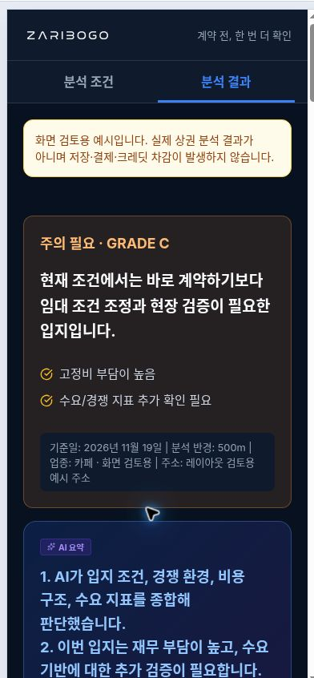

# Codex 개발 인계

기록일: 2026-11-19 (한국시간)

## 현재 상태

- 소스 기준: `bigbearboss/-zaribogo`, 시작 커밋 `dc7f4f6`.
- 이번 작업 브랜치: `codex/mobile-ready`.
- 기존 Vite/TypeScript 구조를 유지한다. 새 프레임워크나 새 DB로 이전한 것이 아니다.
- 소스를 Codex 환경에서 실행했고 모바일 화면을 수정했다. 실제 배포는 별도 단계다.
- 기존 Antigravity 컴퓨터의 미커밋 파일과 `.env`는 이 Git 저장소에 포함되어 있지 않으므로, 원본 로컬 작업이 있다면 별도 비교해야 한다.
- 개발 환경에 실제 API 설정값이 없어 로그인·지도·실데이터 분석·저장·결제를 통합 검증하지 못했다.

## 실행

Node 24에서 `npm ci`, `npm run doctor`, `npm run dev` 순으로 실행한다. 일반 Vite 개발 포트는 5175다. 관리형 Codex Sites 프리뷰 런타임에서는 해당 환경의 `sites-preview start <저장소 절대 경로>`를 사용하며, 일반 개발 서버를 중복 실행하지 않는다.

`npm run build`는 타입 검사 후 정적 파일을 `dist/`에 생성한다. 이 명령은 Supabase 함수나 DB 마이그레이션을 배포하지 않는다.

## 기존 설정 연결

`.env.example`을 `.env.local`로 복사하고 기존 프로젝트의 값을 옮긴다. `.env.local`은 Git에서 제외된다. 서버 비밀키를 `VITE_*`로 만들면 클라이언트 번들에 노출되므로 서버 설정에만 둔다.

| 변수 | 용도 / 확인할 사항 |
| --- | --- |
| `VITE_SUPABASE_URL` | 기존 Supabase 프로젝트 URL |
| `VITE_SUPABASE_ANON_KEY` | 기존 브라우저용 publishable 또는 anon 키. service role 키 사용 금지 |
| `VITE_SUPABASE_LEGACY_ANON_KEY` | 기존 AIService가 Authorization 헤더에 사용하는 legacy anon 키. 로그인 클라이언트의 대체 키로도 사용됨 |
| `VITE_KAKAO_MAP_APP_KEY` | Kakao JavaScript 키. 개발 및 프리뷰 주소가 허용 도메인에 포함되어야 함 |
| `VITE_AI_PROXY_URL` | 기존 AI 엔드포인트. 기본 `/api/ai-summary`는 Vite만 실행하면 제공되지 않음 |
| `VITE_CSV_BASE_URL` | 외부 상권 CSV 경로. 미설정이면 기존 코드의 상대 경로를 사용하므로 실제 파일 존재 확인 필요 |
| `VITE_ODCLOUD_API_KEY` | 공공데이터 클라이언트 요청용 설정 |
| `VITE_ODCLOUD_BASE_URL` | 공공데이터 API 주소 |
| `VITE_TOSS_CLIENT_KEY` | 기존 결제 클라이언트 설정. 실제 결제 연결을 별도 검증 |

`OPENAI_API_KEY`, `SUPABASE_SERVICE_ROLE_KEY`, SGIS 비밀키, 결제 secret/webhook 키는 기존 Cloudflare/Supabase 서버 설정에 유지한다. 프런트엔드 작업만을 위해 새로 발급하거나 복제하지 않는다.

현재 AIService 구현은 브라우저 키와 legacy anon 키가 모두 있어야 요청한다. 인증 방식 변경은 이번 UI 작업에 포함하지 않았다. 서버 endpoint, CORS, Auth redirect 허용 주소를 실제 프로젝트 설정과 맞춰 확인해야 한다.

## 모바일 변경

- 1023px 이하에서 조건 입력 / 결과 탭으로 분리하고 입력 DOM을 유지한다. 1024px 이상에서는 기존 좌우 구성을 사용한다.
- 입력 버튼은 모바일 하단에 고정한다. 안내 문구가 여러 줄이면 실제 버튼 영역 높이만큼 여백을 확보한다.
- 입력창은 16px 이상 글꼴, 주요 조작은 44~52px 이상 높이를 사용한다. 작은 화면의 입력과 결과 카드는 한 열로 배치한다.
- 고급 설정은 기본 접힘으로 변경했고 펼침 표시가 상태와 일치한다.
- 모바일 메뉴의 열림 상태, Escape 닫기, 업종 버튼/탭 키보드 접근, 입력 라벨을 추가했다.
- 지도 내부 모든 div를 강제로 확장하던 스타일을 제거했다. 지도 컨테이너 크기가 바뀌면 `relayout()`하도록 했다.
- 지도 SDK가 실패해도 업종 선택과 기본 조작이 초기화된다.
- 로그인되지 않은 분석 요청을 정상적인 안내 상태로 처리한다. 요청 중 중복 클릭을 막고 실패 후 버튼을 복구한다.
- CRI 계산, DB 스키마, 결제·환불, 크레딧 차감 로직은 변경하지 않았다.

## 코드 위치

| 경로 | 역할 |
| --- | --- |
| `index.html` | 소개/입력/결과 DOM |
| `src/ui/appShell.ts` | 페이지 전환, 모바일 탭, 접근성, 상태 안내 |
| `src/responsive.css` | 마지막에 로드되는 반응형 스타일 |
| `src/main.ts` | 입력·분석·저장·리포트 연결 |
| `src/map/KakaoMapManager.ts` | Kakao 지도와 크기 변경 대응 |
| `src/engine/` | 기존 CRI·재무·데이터 분석 |
| `src/services/` | 인증, 지도 SDK 등 연동 |
| `supabase/functions/`, `supabase/migrations/` | 기존 서버 함수와 DB 변경 이력 |
| `functions/api/ai-summary.ts` | Cloudflare AI 서버 경로 |
| `dev/responsive.html`, `src/dev/responsivePreview.ts` | 개발 전용 화면 검토 |

## 검증 기록

- `npm ci`, `npm run doctor`, `npm run build`(타입 검사 포함), `git diff --check` 성공. 설정 점검은 실제 API 변수들이 미설정임을 보고했다.
- Chromium의 iframe CSS viewport 320/360/390/430/768/1024/1440px에서 소개 페이지, 펼친 입력 폼, 가상 리포트에 가로 넘침이 없음을 DOM 경계 측정으로 확인했다.
- 모바일 탭을 왕복한 뒤 월세 입력값이 유지됨을 확인했다.
- 업종 선택, 고급 설정 펼침, 연결 불가 안내 및 분석 버튼 복구, 메뉴 열림/Escape, 키보드 테마 전환, 방향키 탭 전환, 홈 복귀를 확인했다.
- 390px 샘플 리포트 팝업이 화면 안에 들어오는 것을 확인했다.
- 320px에서 긴 안내 문구가 표시되어도 마지막 입력칸이 하단 버튼 위로 스크롤되는 것을 확인했다. 스크롤 중 상단 탭도 고정된다.
- 비로그인 마이페이지가 홈으로 돌아오는 것은 확인했지만, 로그인 후의 내역/결제/프로필 화면은 검증하지 못했다.
- 실제 Kakao 지도 relayout, 지도 검색, 로그인, AI 응답, 저장/크레딧 차감, 결제는 설정 연결 후 확인해야 한다.
- 실제 iOS/Android 키보드 및 노치 동작은 기기 점검이 남아 있다.

## 다음 연동 확인 순서

1. Antigravity에 남은 미커밋 소스 유무를 확인하고, 기존 `.env`의 클라이언트 설정을 개발 환경에 연결한다.
2. 허용된 개발 주소에서 로그인과 지도 검색을 확인한다. 390px → 1024px 전환 및 탭 왕복 시 지도가 정상적으로 다시 그려지는지 확인한다.
3. 검증 계정으로 분석 한 번을 실행해 결과 표시, 저장, 크레딧 1회 차감, 마이페이지 재열기를 확인한다. 반복 클릭이 중복 분석으로 이어지지 않는지 확인한다.
4. 결제 관련 화면은 테스트 설정으로 확인하고 기존 Cloudflare 배포 브랜치/환경변수를 확인한다.
5. 검증된 브랜치를 운영 브랜치에 반영한 뒤 기존 도메인에서 최종 확인한다.

기존 빌드에는 큰 JavaScript 번들 경고가 있다. 의존성 업그레이드와 코드 분할은 별도 작업으로 검토한다.

## 화면 기록

390px CSS viewport의 개발 화면이다. 리포트는 가상 데이터이며 지도는 API 설정이 없는 상태다.

| 조건 입력 | 결과 예시 |
| --- | --- |
|  |  |
